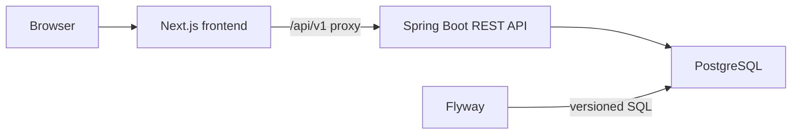

# InternFlow

**Turn applications into momentum.** InternFlow is a student-first workspace for organizing early-career applications, deadlines, preparation tasks, and next actions.

## Current implementation status

The public landing, registration, and login pages are implemented. The Java API supports account registration, BCrypt password hashing, login/logout, current-account lookup, server-side JDBC sessions, and CSRF protection. The authenticated applications workflow has persisted create/list/detail/update/delete operations, status filtering and text search, pagination, and status activity history. Student profile viewing and updating use the existing `student_profiles` table, with ownership taken from the authenticated account. Task management provides persisted create/list/detail/update/delete operations, task completion, status/priority/category/application/deadline filters, text search, pagination and sorting. The authenticated shared opportunity catalogue provides paginated search, filtering, and detail views. Its authenticated fit-assessment endpoint compares the signed-in student's profile with a catalogue record without storing results. Catalogue records are not user-owned and are not asserted to be live or independently verified. Task and application ownership are enforced using the authenticated account; tasks cannot link to another user's application. The responsive `/profile`, `/tasks`, and `/opportunities` pages use the same-origin API proxy. Backend integration tests cover these workflows against PostgreSQL.

This is a workflow slice, not the complete product. The dashboard, calendar, analytics, import/export, catalogue administration, and the full design-system shell remain unimplemented in this checkout. The catalogue starts empty; no fabricated records are inserted. Database-backed integration tests require the PostgreSQL Compose service to be running.

## Architecture



The backend is a Java 21 modular monolith. PostgreSQL is the source of truth and Flyway owns schema changes; Hibernate is configured to validate rather than update the schema. The frontend proxies `/api/v1` to `http://localhost:8081` by default. Override this server-side with `BACKEND_API_URL` in the frontend process if the API uses another address; it is not a `NEXT_PUBLIC_*` variable and is not exposed in browser bundles. The browser uses same-origin requests through the Next.js rewrite, so the Spring session and CSRF cookies remain same-origin; it requests a CSRF token before state-changing operations and does not store credentials or session IDs in browser storage.

## Prerequisites

- Java 21 LTS
- Node.js 24 LTS and npm
- Docker Desktop with Docker Compose

The backend includes Maven Wrapper scripts, so a global Maven installation is not required.

## Local setup (Windows PowerShell)

Install Java 21 LTS and Node.js 24 LTS using their standard Windows installers, and ensure both are available on `PATH`. Open PowerShell from the repository root and verify the installed versions:

```powershell
java -version
node --version
npm --version

if (-not (Test-Path .env)) {
    Copy-Item .env.example .env
}
```

If you created `.env` from the example, replace its database password locally with a unique value and use the same value for both PostgreSQL and the backend datasource. Never commit `.env`.

Start the local database:

```powershell
docker compose up -d
docker compose ps
```

Install and run the frontend:

```powershell
Set-Location frontend
npm.cmd ci
npm.cmd run lint
npm.cmd run build
$env:BACKEND_API_URL = "http://localhost:8081"
npm.cmd run dev
```

The frontend is available at `http://localhost:3000`. Keep this terminal open while using the application.

In a second PowerShell terminal, from the repository root, run the backend:

```powershell
Set-Location backend
.\mvnw.cmd test
.\mvnw.cmd spring-boot:run
```

The backend imports the root `.env` when started from the `backend` directory. The example configures the Spring API at port 8081; its health endpoint is `http://localhost:8081/actuator/health`. Health and OpenAPI documentation endpoints are public, while private API routes require authentication. Authentication endpoints are `/api/v1/auth/csrf`, `/register`, `/login`, `/me`, and `/logout`. Sessions are persisted in PostgreSQL, with the `INTERNFLOW_SESSION` cookie configured HttpOnly and SameSite=Lax; set `SESSION_COOKIE_SECURE=true` behind HTTPS. The API process and ORM are configured to use UTC.

OpenAPI JSON is available at `http://localhost:8081/v3/api-docs`; Swagger UI is at `http://localhost:8081/swagger-ui.html`.

If the API port needs to differ, set `SERVER_PORT` in the backend environment and `BACKEND_API_URL` in the frontend environment to the same API address. The frontend variable is read by Next.js server configuration only and must not use a `NEXT_PUBLIC_` prefix.

```powershell
# Backend terminal
$env:SERVER_PORT = "8082"
.\mvnw.cmd spring-boot:run

# Frontend terminal
$env:BACKEND_API_URL = "http://localhost:8082"
npm.cmd run dev
```

Flyway automatically applies pending migrations at backend startup. V1 creates users, student profiles, user-owned opportunities, applications, application events, tasks, and notification preferences. V2 creates the JDBC-backed Spring Session tables. V3 creates the separate shared `opportunity_catalogue` table without a user owner or an application relationship. No demo rows are inserted.

## Current checks

```powershell
# From the backend directory
.\mvnw.cmd verify

# From the frontend directory
npm.cmd run lint
npm.cmd run build
```

The integration tests connect to the configured PostgreSQL database, check the PostgreSQL version and Flyway history, verify expected tables, exercise health and authentication endpoints, test CSRF behavior and session invalidation, verify application CRUD and status activity, and cover task CRUD, filters, deadlines, completion, validation, and cross-user ownership including foreign-application linking. Opportunity catalogue tests cover the V3 schema, authenticated listing and pagination, search and filters, detail, not-found behavior, and request validation. Fit-assessment tests cover exact skill matching, unknown profile data, inclusive graduation-year checks, role/location/work-mode comparisons, missing profiles/opportunities, authentication, and profile isolation. Run `.\mvnw.cmd verify` to execute the full backend verification suite.

## Known limitations

- The authenticated dashboard, calendar, and database-derived analytics do not exist yet. Fit assessment uses exact normalized text comparisons (not semantic matching), is not a hiring prediction, and does not persist results. The catalogue has no authoring/admin workflow and no bundled listings.
- Application CRUD uses the existing V1 schema and requires a running backend and PostgreSQL database.
- Registration, login, application, and profile UI use the same-origin Next.js API rewrite to the real Spring backend. A running backend and PostgreSQL are required.
- `npm audit` reports five high-severity dependency-path findings in the development-only Next.js ESLint chain: `eslint-config-next` → `@next/eslint-plugin-next` → `fast-glob` → `micromatch` → `braces`. The underlying advisory is GHSA-vfj7-8cjw-p6xm (CVSS 7.5), affecting `braces <=3.0.3`. The registry currently offers no newer `braces` release; npm's suggested fix downgrades `eslint-config-next` to 14.2.35, so it is incompatible with this Next.js 16.4 project and was not applied.
- `npm audit --omit=dev` reports zero production dependency vulnerabilities. No compatible fix for the dev-only ESLint advisory was available at the time of this check.
- In this workspace, `mvnw.cmd clean verify` could not delete a locked directory under `backend/target`; `mvnw.cmd verify` completed successfully. Port 8080 is occupied by a local Oracle TNS listener; the local API defaults to port 8081.
- A direct Next.js production build in the OneDrive-synced frontend folder can fail with Windows `EPERM` while unlinking `.next\server\app\applications`; this remains unresolved. Recent lint/build verification used the current sources, with the production build run from an isolated copy outside OneDrive.
- Profile management reuses the `student_profiles` table from Flyway V1; it requires no schema migration. Profile integration tests verify authentication, CSRF, validation, user scoping, and persistence against PostgreSQL.
