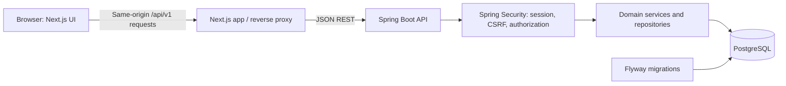

# InternFlow Architecture

**Status:** Backend foundation, session authentication, CSRF protection, public registration/login UI, and persisted application and student-profile workflows are implemented. Profile and application operations are scoped to the authenticated principal and covered by PostgreSQL-backed integration tests. Task CRUD and other product workflows remain future phases in this checkout.

## Decisions

- **Frontend:** Next.js 16.4.1 App Router, React 19.3.0, TypeScript 6.0.3, Tailwind CSS, and shadcn/ui. TypeScript 6.0.3 satisfies the installed Next ESLint tooling peer range (`>=4.8.4 <6.1.0`) and passed lint and production build checks; TypeScript 7 is not accepted by that tooling yet.
- **Backend:** Java 21 LTS with Spring Boot 4.1.1, Spring MVC, Spring Security, Spring Data JPA, Bean Validation, Actuator, and Maven Wrapper. Use a modular monolith: one deployable Java REST API with domain package boundaries.
- **Database:** PostgreSQL 18.x (18.6 is the researched stable minor on 2026-10-15). Use Flyway-owned, versioned migrations; do not depend on production `ddl-auto=update`.
- **API:** JSON REST endpoints under `/api/v1`, DTOs rather than exposed JPA entities, pagination for growing collections, and structured validation/error responses.
- **Authentication:** Spring Security with server-side sessions persisted through Spring Session JDBC; use an HttpOnly, Secure-in-production, SameSite cookie and CSRF protection. Do not put long-lived tokens in browser localStorage. Logout invalidates the server session. A single-origin reverse proxy from the frontend to the Java API is the deployment assumption; configure local Next.js rewrites similarly. If hosting requires cross-site browser cookies, revisit the proxy/session design and document CORS/CSRF behavior before deployment.
- **External services:** None required for the core product. Use a managed PostgreSQL provider or local PostgreSQL; Docker Compose is the preferred reproducible local database option if Docker Desktop is available.

## Request and Data Flow

The browser uses a small typed API client against the same public origin. The Java service owns business rules, validation, authentication, authorization, and database access. The Next.js proxy is transport plumbing, not a second application backend: it must not duplicate domain rules or persist application data. No Python runtime or service is part of this architecture.

Authentication is exposed at `/api/v1/auth`: the CSRF endpoint provides a token for state-changing requests; registration stores BCrypt hashes; login establishes a JDBC-backed Spring Security session; `/me` returns only the authenticated account DTO; and logout invalidates the session. The session cookie is named `INTERNFLOW_SESSION`, HttpOnly, SameSite=Lax, and Secure when `SESSION_COOKIE_SECURE=true`. The CSRF cookie is intentionally readable by the same-origin frontend and is also SameSite=Lax. The frontend sends the returned CSRF token in its named header and never stores passwords or session IDs in localStorage.

The student profile is exposed at `/api/v1/profile` as a self-only GET/PUT resource. Its owner is always taken from `AccountPrincipal`; the request DTO contains no owner identifier. The frontend accesses it through the same-origin API proxy and uses the existing V1 `student_profiles` table.

## Java Package Boundaries

Organize backend code by domain, with a small shared `common` area:

- `auth`: registration, login/logout, current-session behavior, and security configuration.
- `user` and `profile`: account and student eligibility information.
- `opportunity`: saved opportunity details and fit assessments.
- `application`: application CRUD, ownership, status transitions, and activity history.
- `task`: task CRUD, completion, and application association.
- `calendar`: agenda projections from persisted records.
- `analytics`: user-scoped aggregates and explicitly defined metric calculations.
- `notification`: persisted preferences and in-app due/overdue alerts when implemented.
- `common`: API error model, configuration, and shared utilities only where reuse is real.

Controllers stay thin. Services hold rules and transaction boundaries. Repositories query with the authenticated user's identity included. Request/response DTOs are validated at the API boundary. Add a regression test whenever a user-scoped read or mutation is introduced.

## Data Model (Initial Direction)

- `users`: unique normalized email, BCrypt password hash, timestamps.
- `student_profiles`: one-to-one user relationship and eligibility/profile fields.
- `opportunities`: user-owned saved role details and requirements.
- `applications`: user-owned tracker record; optional opportunity link; status, dates, priority, notes, and document reference.
- `application_events`: user/application-owned history for status and meaningful activity changes.
- `tasks`: user-owned, optionally linked to an application; due time, priority, category, completion state.
- `notification_preferences`: one-to-one user settings, added only for settings that actually persist.
- Spring Session JDBC tables: server-side session persistence, managed through the selected Spring Session schema/migration approach.

Every user-owned table has an ownership key and foreign keys. All repository/service operations filter by the authenticated user; possession of a UUID is never authorization. Index ownership and common status/deadline filters. Let Flyway control schema creation and upgrades. Decide exact constraints and cascade rules alongside the first migration, before exposing CRUD.

Flyway migrations `V1` and `V2` now create the domain foundation and Spring Session JDBC tables. Composite `(user_id, id)` foreign keys prevent applications from referencing another user's opportunity and prevent tasks or events from crossing application ownership. Deleting an opportunity unlinks it from an application; deleting an application cascades to its tasks and events. Spring Session schema auto-initialization is disabled so Flyway remains the schema owner.

Task management uses the existing V1 `tasks` table without a follow-up migration. The authenticated API supports CRUD, pagination, status/priority/category/application/deadline and overdue filters, free-text search, and configurable sorting. A task's owner comes from the server-side principal; the composite application relationship prevents linking it to another user's application.

Store instants/timestamps in UTC and serialize them with offsets. Use date-only values for deadlines that are truly calendar dates. Document the default display timezone (UTC initially) until user timezone preferences are implemented.

## Security and Data Integrity

- BCrypt via Spring Security; never store or log plaintext passwords, session identifiers, or secrets.
- Validate requests on the server and client; return field-specific RFC 9457 `ProblemDetail` responses without stack traces.
- Session cookies are HttpOnly and SameSite; require Secure in production. Protect cookie-authenticated state-changing requests with CSRF tokens.
- Restrict CORS to configured origins if any cross-origin traffic remains; never expose database credentials to frontend variables.
- Scope every application, opportunity, task, event, analytics query, and export to the current user. Scope profile reads and updates to the authenticated principal; do not accept a client-provided user ID as ownership evidence.
- Add integration tests for unauthenticated access and cross-user read/update/delete, plus service tests for status transitions, metrics, and fit rules. Authentication tests exercise session creation/invalidation, CSRF, and safe credential errors. Application integration tests cover persisted CRUD, filtering, activity, validation, unauthenticated rejection, and cross-user read/update/delete; the tests pass against PostgreSQL, with additional ownership checks through live HTTP requests.
- Task integration tests cover PostgreSQL CRUD, filters, deadlines, completion, text search, unauthenticated rejection, CSRF, cross-user read/update/delete, and attempts to link another user's application; service tests cover task validation and due/completion behavior.
- Load secrets from environment variables. Commit only placeholder `.env.example` files; ignore real `.env` files and build outputs.
- Student profile integration tests verify unauthenticated rejection, field validation, CSRF protection, user isolation, and PostgreSQL persistence. Flyway V1 already creates the one-to-one profile table, so this workflow adds no migration.

## Fit and Metrics Rules

Fit is a deterministic backend service, not generative AI. It compares explicit opportunity requirements with the user's profile and returns a label plus categorized matches, unknowns, and blockers. Unknown profile values do not count as blockers. Keep the scoring/label thresholds documented and cover them with unit tests before the UI relies on them.

Analytics and dashboard values are derived from records owned by the current user. Define denominators in code/docs, use empty/insufficient-data states, and ensure no seed data appears in an ordinary user's account without explicit consent.

## Version Baseline (Researched 2026-10-15)

| Component | Proposed baseline | Notes |
| --- | --- | --- |
| Node.js | 24.22.0 LTS | Node release page lists 24 as LTS; Node 26 is Current, not the production LTS choice. |
| Next.js | 16.4.x | Official Next.js blog lists 16.4 on 2026-10-06. |
| React | 19.3.x | Next.js 16.4 announcement references React 19.3 features. |
| TypeScript | 6.0.3 | Used instead of the planned 7.0.x because installed TypeScript-ESLint peer range is `<6.1.0`; verified with frontend lint and production build. |
| Java | 21 LTS | Use a supported LTS JDK. Spring Boot 4.1.1 documents Java 17 through 26; Java 27 is outside that range. |
| Spring Boot | 4.1.1 | Official requirements page lists Maven 3.6.3+ and Java 17-26. Spring Boot dependency management should align Spring, Hibernate, Flyway, and test libraries. |
| Maven / Wrapper | 3.10.0 / 3.3.4 | The checked-in wrapper downloads Maven 3.10.0; the wrapper scripts are version 3.3.4. A global Maven install is not required. |
| PostgreSQL | 18.6 / 18.x | Stable supported major/minor per the PostgreSQL versioning page; do not use PostgreSQL 19 RC for the app. |

Use lockfiles and the Spring Boot BOM to pin exact transitive and patch versions. The frontend lockfile pins the validated Next.js 16.4.1/React 19.3.0/TypeScript 6.0.3 toolchain. The backend uses the Java 21 compiler release, Maven Wrapper, PostgreSQL driver, Flyway, Spring Session JDBC, and Boot-managed dependencies.

The current npm audit reports five high-severity dependency-path findings from one advisory: `braces` versions `<=3.0.3` (GHSA-vfj7-8cjw-p6xm, CVSS 7.5) through `micromatch`, `fast-glob`, and `@next/eslint-plugin-next` in the development-only `eslint-config-next` chain. Registry versions checked on 2026-10-16 still list `braces` 3.0.3 as latest. npm's automatic remediation downgrades `eslint-config-next` to 14.2.35, incompatible with Next.js 16; no downgrade, force fix, or suppression was applied.

## Deployment Shape

For local development, run the Next.js app and Spring API separately, route `/api/v1` through Next.js rewrites, and run PostgreSQL locally or in Docker. In deployment, prefer a frontend/API arrangement behind one browser origin so session cookies and CSRF behavior stay simple. Document the actual host's proxy, environment variables, health route, allowed origins, cookie flags, and migration process before declaring deployment support. Managed PostgreSQL is acceptable; only the backend receives database credentials.

## Official Version References

- Next.js release history: https://nextjs.org/blog
- Spring Boot system requirements: https://docs.spring.io/spring-boot/system-requirements.html
- PostgreSQL versioning and support: https://www.postgresql.org/support/versioning/
- Node.js release schedule: https://nodejs.org/en/about/previous-releases
- TypeScript downloads: https://www.typescriptlang.org/download/